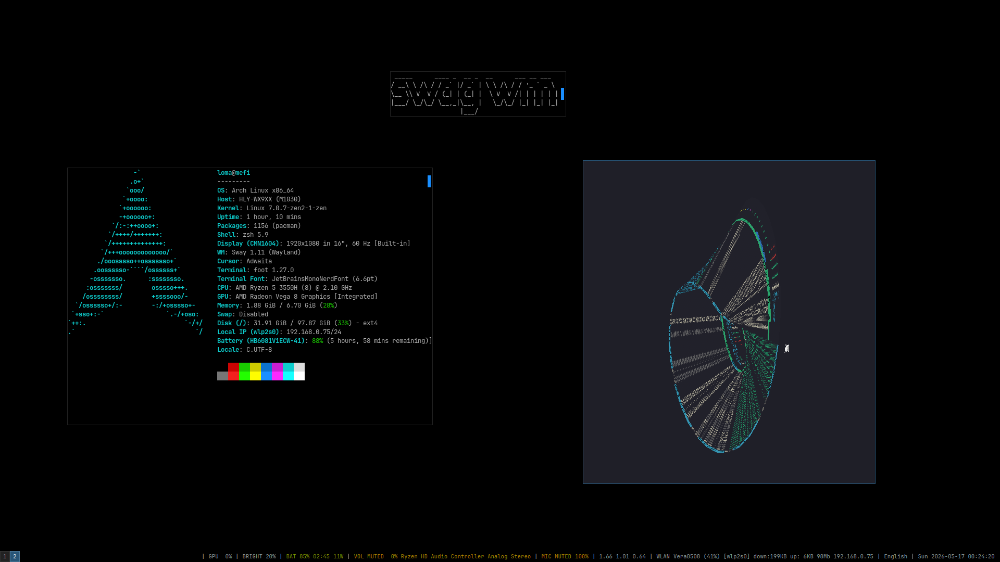
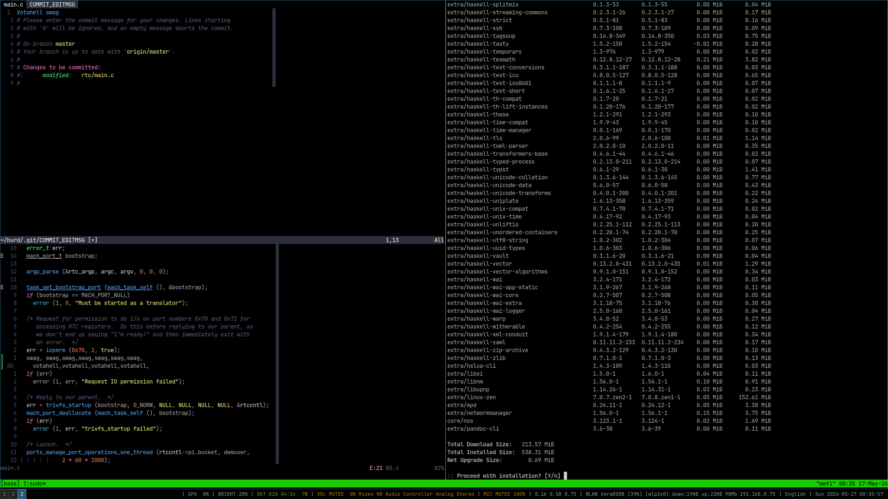
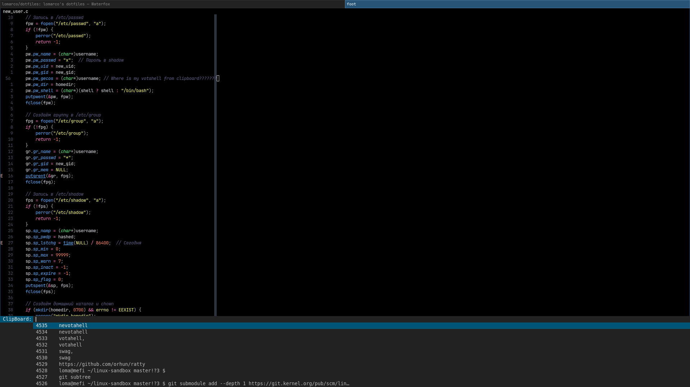

# Lomarco's Dotfiles

<p align="center">
  
</p>

<details open>
  <summary>Contents</summary>

- [Toolchain](#toolchain)
- [Gallery](#gallery)
- [Repository Structure](#repository-structure)
  - [Base](#base)
  - [Scripts](#scripts)
- [Install Guide](#install-guide)
- [Sway Hotkeys](#sway-hotkeys)
- [NeoVim Config](#Neovim-config)
- [License](#license)

</details>

## Toolchain
|                |                |
|----------------|----------------|
| ***Window Manager*** | [***`Sway`***](https://swaywm.org) |
| ***Status Bar*** | [***`Swaybar & I3status-Rust`***](https://github.com/greshake/i3status-rust) |
| ***Terminal*** | [***`Foot`***](https://codeberg.org/dnkl/foot) |
| ***Shell*** | [***`Zsh & Rac`***](https://github.com/lomarco/rac) |
| ***Editor*** | [***`NeoVim`***](https://neovim.io) |
| ***Web Browser*** | [***`Waterfox`***](https://www.waterfox.com/) |
| ***Multiplexer*** | [***`Tmux`***](https://github.com/tmux/tmux/wiki) |
| ***Password Manager*** | [***`Pass`***](https://www.passwordstore.org) |
| ***WiFi Manager*** | [***`Network Manager`***](https://networkmanager.dev) |
| ***Notification Manager*** | [***`Fnott`***](https://codeberg.org/dnkl/foot) |
| ***File Manager*** | [***`Yazi`***](https://yazi-rs.github.io) |
| ***Pdf Reader*** | [***`Zathura`***](https://pwmt.org/projects/zathura) |
| ***Notes Manager*** | [***`Noca`***](https://github.com/lomarco/noca) |
| ***Bootloader*** | [***`EFI Stub`***](https://github.com/lomarco/dotfiles/blob/master/bin/efistub-boot) |

## Gallery

<p align="center">
  
  <br />
  
</p>

## Repository Structure

### [base-packages](https://github.com/lomarco/dotfiles-arch/blob/master/base-packages) - List of base packages.
### [base-aur-packages](https://github.com/lomarco/dotfiles-arch/blob/master/base-aur-packages) - List of base aur packages.
### [extra-packages](https://github.com/lomarco/dotfiles-arch/blob/master/extra-packages) - List of extra packages.
### [extra-aur-packages](https://github.com/lomarco/dotfiles-arch/blob/master/extra-aur-packages) - List of extra aur packages.
### [nixos](nixos) - /etc/nixos/ directory for nixos.

### Home

- [Sway](home/.config/sway/config)
- [I3status-Rust](home/.config/i3status-rust/config.toml)
- [Foot](home/.config/foot/foot.ini)
- [Zsh](home/.zshrc)
- [NeoVim](home/.config/nvim/init.lua)
- [Tmux](home/.config/tmux/tmux.conf)
- [Vim](home/.vimrc)
- [Git config](home/.gitconfig)
- [Fnott](home/.config/fnott/fnott.ini)
- [Gnupg](home/.gnupg/gpg-agent.conf)

### Scripts

- [auto\_backup](bin/auto_backup)
- [efistub-boot](bin/efistub-boot)
- [aupa](bin/aupa)
- [crpt\_price](bin/crpt_price)
- [blink](bin/blink)
- [supqmk](bin/supqmk)


## Install Guide
Init and update submodules:
```bash
git submodule update --init --recursive
```

Update to latest changes:
```bash
git submodule update --remote
```

Install and select configs (home config for example. See `make help` for information):
```bash
make home
```

## License
Lomarco's Dotfiles is licensed under the Unlicense. See the [license](LICENSE) for details.
